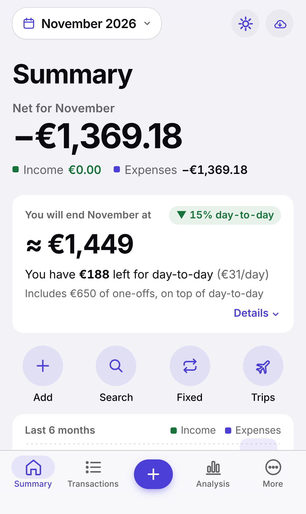
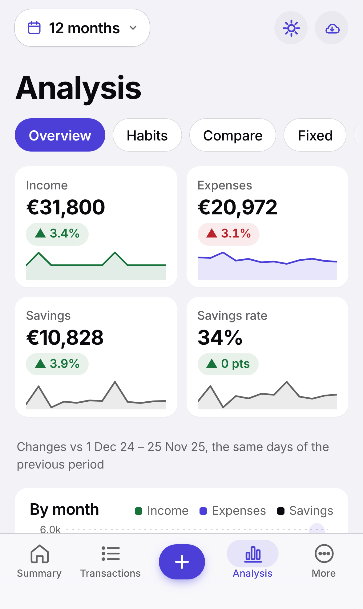
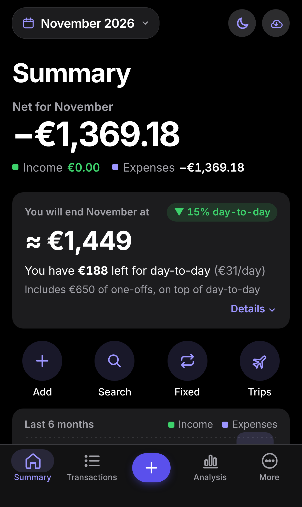
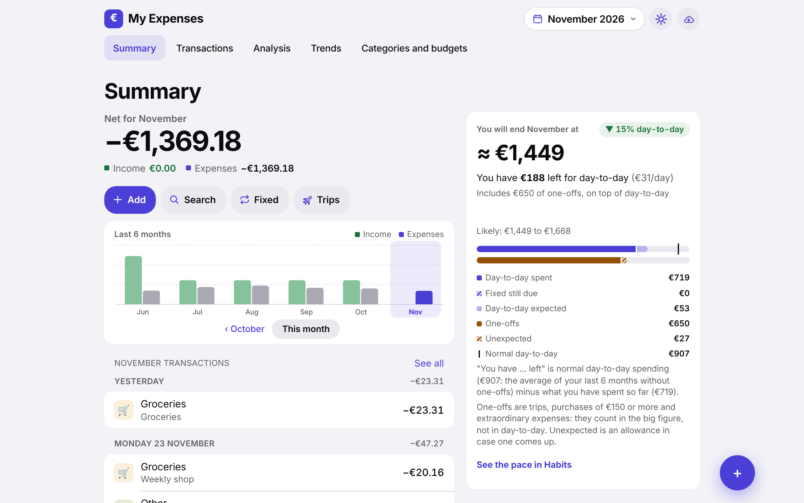
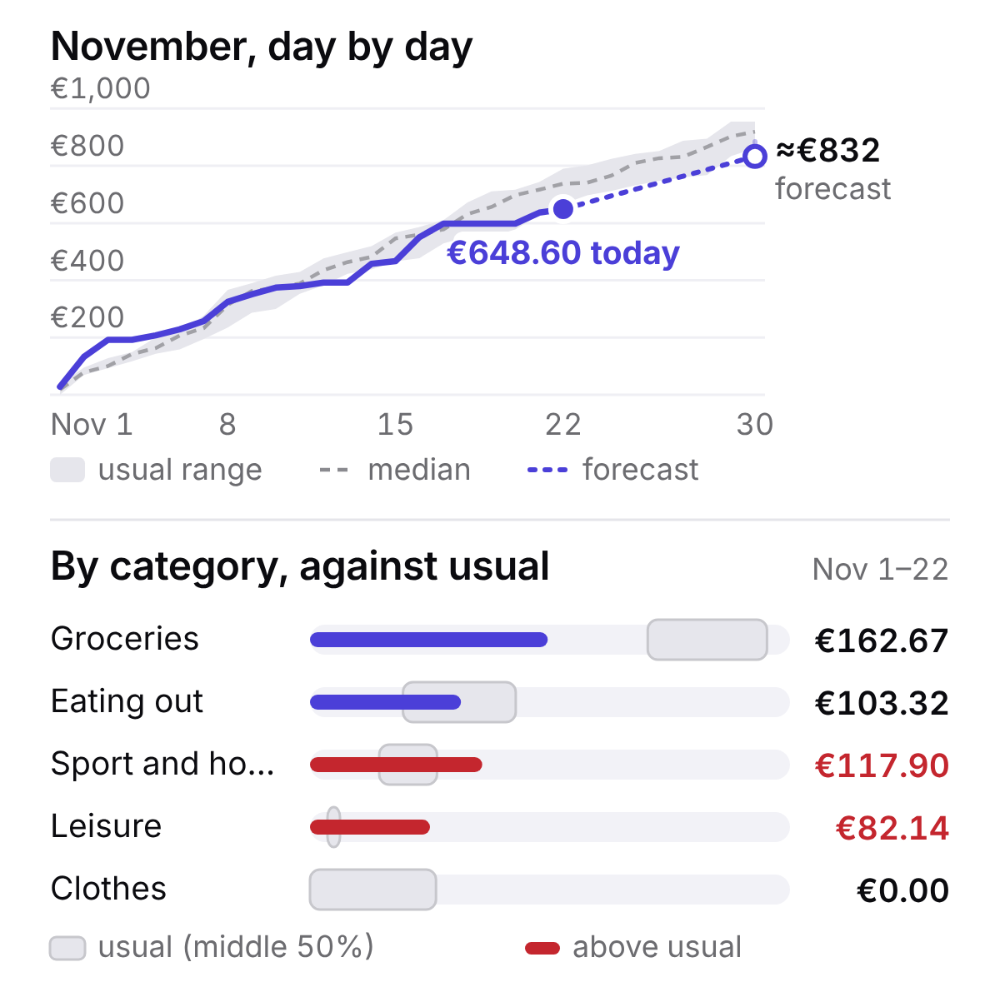

# My Expenses

A personal expense and income tracker in **a single HTML file**: no server, no dependencies, no account. It runs in the browser on mobile and desktop, has light and dark themes, and besides recording transactions it tells you how you are doing: end-of-month forecast ("You have €X left for day-to-day"), fixed payments, habit changes, trips and alerts.

It also includes a **weekly email summary** (headline, a few sentences and one chart) generated with Python from the same data.

> All data in this repository is **invented** (`sample-data/`). There are no real transactions from anyone.

| Summary (mobile) | Analysis | Dark mode |
|---|---|---|
|  |  |  |



## Try it

- **Demo:** open [`docs/index.html`](docs/index.html) in your browser, or the GitHub Pages version if enabled (*Settings → Pages → Deploy from a branch → `main` / `docs`*). The first time it loads 897 invented transactions, shifted in time so the last month is the current one. Anything you add is stored only in your browser.
- **Start with your own data:** open [`app/my-expenses.html`](app/my-expenses.html) (download it and open the file). Outside claude.ai it keeps everything in your browser and, when there is no data yet, starts with 16 basic categories. You can import a CSV from your bank or another app (it detects date, amount, type, category and note columns, in English or Spanish) and export backups as CSV or JSON.

## Features

- **Summary:** month net, income and expenses, last 6 months, alerts and a **forecast card**: how the month will end (the real total, one-offs included), a "▲/▼ X% day-to-day" pill against your normal day-to-day spending, and **"You have €X left for day-to-day (€Y/day)"** (or "You are €X over"). When the pill is red it adds "You will end ≈ €X above normal", and when the month has one-offs, "Includes €X of one-offs, on top of day-to-day". On mobile the card is short; "Details" opens the range, a two-bar chart (day-to-day with the "normal" mark, one-offs apart) and what each figure means.
- **Safe to use offline or on a flaky connection** (when published as a claude.ai artifact): every change goes to an outbox in the browser before it is sent and stays there until the cloud confirms it, so nothing is lost on a reload; a write that hangs counts as offline after 8 s; settings are synced field by field so two devices do not overwrite each other; a line says "N pending changes" or "Offline · Retry", and if the cloud does not answer in 15 s you get an error screen with Retry instead of an endless skeleton.
- **Transactions:** list by day with search (accent-insensitive, every word must match, and it offers matches outside the current period), filters, editing, multi-select (change category, mark extraordinary, delete, all undoable) and labels. It suggests a category as you type the note, keeps an unsaved entry as a draft for 30 minutes, and asks twice before saving an amount far above anything you have entered.
- **Analysis:** overview, habits (the month's pace against normal day-to-day, with the same pill as Summary, pace by category and habit changes), compare periods, **fixed payments** (detects subscriptions and bills, and warns when one goes up, goes down, is missing or a new one appears) and **trips**.
- **Trends** (month by month) and **Categories and budgets**, with colours, icons and a monthly budget.
- **Extraordinary** expenses (a one-off big purchase) that do not distort the "normal month".

## Structure

```
app/
  my-expenses.html     The app. Built to be published as a claude.ai artifact, where it stores data
                       in the artifact's database; anywhere else it uses localStorage.
sample-data/
  generate.py          Generates the invented data (fixed seed: always the same output).
  months/YYYY-MM.json  Transactions per month.
  meta/config.json     Categories.
weekly-email/          Weekly email summary (see below).
docs/
  index.html           Demo with the sample data (built by tools/build_demo.py).
  screenshots/         Screenshots of the demo and the email chart.
  MAINTENANCE.md       How the app is built inside and how to change it without breaking it.
tools/
  build_demo.py        Rebuilds docs/index.html from app/my-expenses.html and sample-data/.
tests/
  calc.test.js         33 checks of the calculations (forecast card, savings, fixed payments, alerts...).
  flows.test.js        17 user flows against a fake cloud (add, move, delete + undo, offline, drafts, guards).
  sync.test.js         36 checks with several devices sharing one fake cloud (offline, hung network, config).
  sync2.test.js        48 fine-grained robustness checks (late writes, duplicates, damaged data, old versions).
  design.test.js       883 layout checks at 320/375/393 px and 150/200 % zoom, light and dark.
  snap.js, snapdiff.js Visual regression: computed style of every screen and a diff between versions.
  tools/cssmerge.py    Safely merges repeated CSS rules.
```

## Data model

Transactions are stored per month (`months/YYYY-MM`) and settings in `meta/config`:

```jsonc
// months/2026-10.json
{ "txs": [
  { "id": "s1a2b3c4d5", "d": "2026-10-03T08:15", "k": "e", "c": "e-transport", "a": 20, "n": "Transport pass" },
  { "id": "s6e7f8a9b0", "d": "2026-10-28T09:05", "k": "i", "c": "i-salary", "a": 2450, "n": "Salary" }
]}
```

| Field | Meaning |
|---|---|
| `d` | Local date and time, `YYYY-MM-DDTHH:MM` |
| `k` | `e` expense, `i` income |
| `c` | Category id (from `meta/config.json`) |
| `a` | Amount, always positive |
| `n` | Free-text note. For trips, the destination goes in the note ("Flights Rome") |
| `l` | Comma-separated labels (optional) |
| `x` | `true` if extraordinary (optional) |

```jsonc
// meta/config.json
{ "cats": [ { "id": "e-groceries", "name": "Groceries", "kind": "e", "icon": "🛒", "color": "#F2A541", "budget": 260 } ],
  "currency": "EUR", "v": 1 }
```

In local mode everything lives in a single `localStorage` key, `gastos.local.v1`, shaped as `{ "txs": [...], "cats": [...] }`. (Internal keys and ids keep their original names so existing data keeps working.)

### How the figures are computed

- **Normal month:** average of the last 6 complete months, excluding extraordinary items.
- **End-of-month forecast:** spent so far + pending fixed payments + expected day-to-day spending + unexpected items. On the sample data, the mean error in the historical back-test (cut-offs on days 5, 10, 15, 20 and 25 of each month) is 16%.
- **One-off expense:** extraordinary, €150 or more, or a trip. Counted in the big figure, kept out of day-to-day.
- **Normal day-to-day:** the normal month without one-offs. It is the single yardstick of the forecast card and of the pace in Habits.
- **"You have €X left for day-to-day":** normal day-to-day − what you have spent without one-offs − fixed payments still due (not one-offs). It is a margin, not a forecast.
- **Pill:** day-to-day forecast vs normal day-to-day. Red when up, green when down, grey within ±5%; not shown before day 5.
- **Fixed payments:** same note or amount in at least 3 months, roughly once a month, with amounts within ±35%.
- **Habit change:** a category or a word in the notes whose median over the last 3 months is at least twice the average of the previous 6 (and at least €25/month more).

More detail in [`docs/MAINTENANCE.md`](docs/MAINTENANCE.md).

## Weekly email summary

`weekly-email/weekly_email.py` reads the data, works out the week and the month, and builds an email ready to send:



**Requirements:** Python 3.10 or later (standard library only), Node.js and Playwright with Chromium (to render the chart as a PNG):

```bash
npm install playwright && npx playwright install chromium
```

**Usage:**

```bash
export MY_EXPENSES_URL="https://link-to-your-copy-of-the-app"   # "Open My Expenses" button (optional)
python3 weekly-email/weekly_email.py --db sample-data --today 2026-11-22 --outdir out
```

`--db` is a folder with the same layout as `sample-data/` (`months/*.json` and `meta/config.json`); `--today` is the last day included (usually a Sunday). If your data lives in the app, export it or dump it into that layout. The script writes to `--outdir`:

- `email.html`: HTML body for the email (the chart is an embedded image, `src="cid:att0"`).
- `email.txt`: the same information as plain text.
- `chart.png`: chart of the month and the categories.
- `data.json`: every computed figure.

It also prints a JSON with the subject, headline, sentences and file paths. The script **does not send anything**: the caller does. In my setup it is a scheduled Claude task that runs on Sunday afternoons, reads the app's data and creates a Gmail draft with `email.html`, `email.txt` and `chart.png` as an inline attachment (see [`weekly-email/example-task.md`](weekly-email/example-task.md)). Any other scheduler (cron, GitHub Actions...) with an SMTP client works just as well.

If the week has no transactions, no image is generated and the email is a single line. The design stays readable when the mail client strips backgrounds, and it has a dark mode for Apple Mail.

## Development

Requirements: Node.js with Playwright (`npm install playwright && npx playwright install chromium`) and Python 3.

```bash
node tests/calc.test.js                                # calculations: all 33 checks must pass
node tests/flows.test.js                               # user flows (17)
node tests/sync.test.js && node tests/sync2.test.js    # sync (36 + 48, about 6 minutes)
node tests/design.test.js                              # layout, contrast, tap size and zoom (883)
node tests/snap.js app/my-expenses.html /tmp/before    # style of every screen (before the change)
# ... make the change ...
node tests/snap.js app/my-expenses.html /tmp/after
node tests/snapdiff.js /tmp/before /tmp/after          # which elements change and in which property
python3 tools/build_demo.py                            # update the demo
```

The tests use `sample-data/` and a fixed date (30 October 2026 for the calculations, 25 November 2026 for the browser tests), so their figures do not depend on the day you run them. If you regenerate the sample data with different rules, the figures change and must be pinned again.

## How it was made

The app was built iteratively with Claude (Anthropic), from v1 to the current v30, with technical review rounds, a round of intensive use as a real user (v20), accuracy back-tests of the forecast on historical data, a redesign that looks like a native iPhone app, and three evaluation rounds (v21–v30) on offline-safe sync, accessibility and a clearer forecast card.

## License

[MIT](LICENSE)
