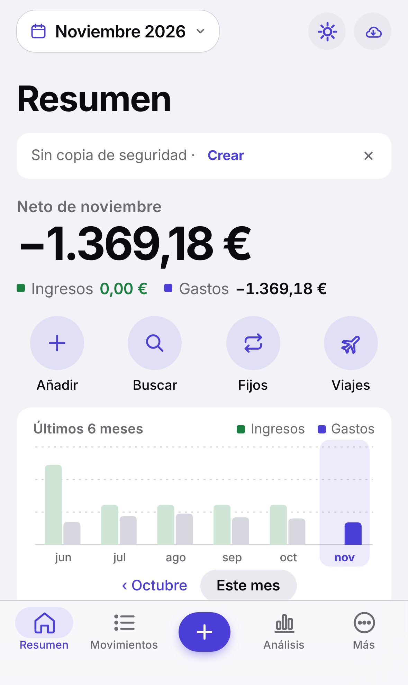
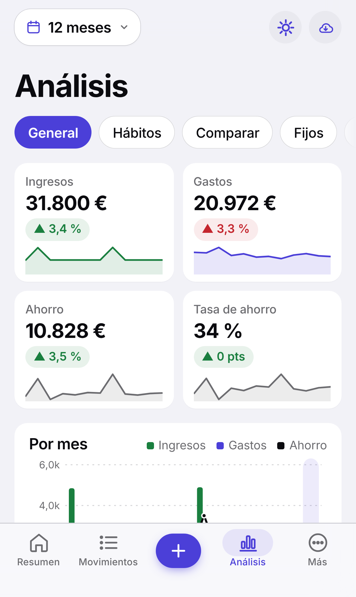
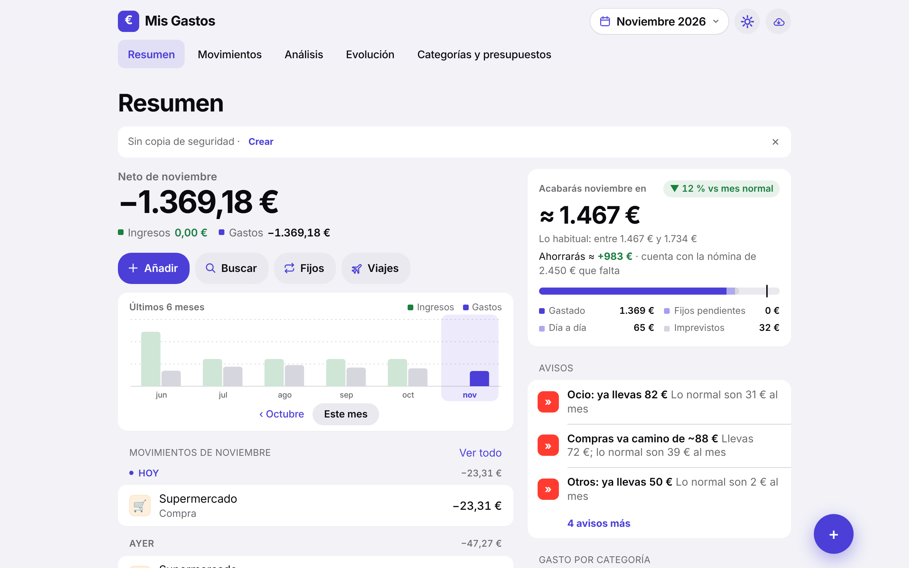
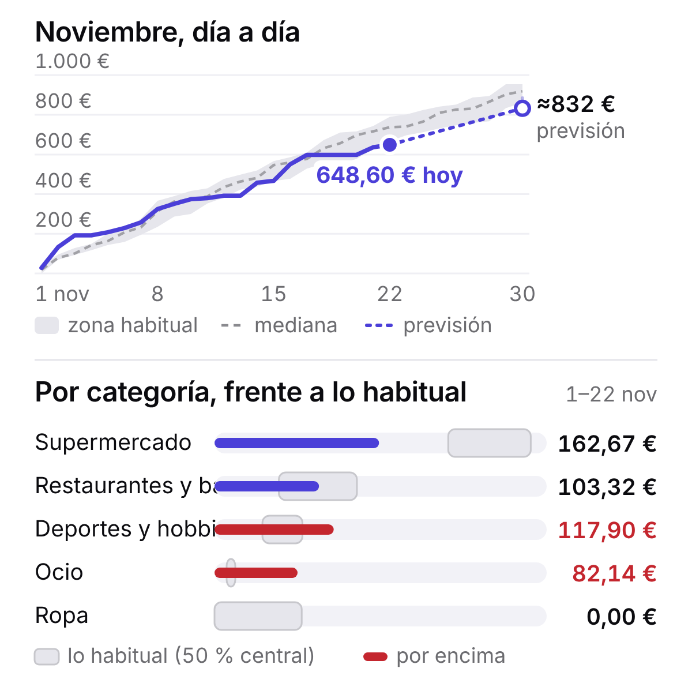

# Mis Gastos

App personal de gastos e ingresos en **un solo archivo HTML**: sin servidor, sin dependencias y sin cuenta. Se abre en el navegador, funciona en móvil y escritorio, tiene tema claro y oscuro, y además de apuntar movimientos te dice cómo vas: previsión de fin de mes, pagos fijos, cambios de hábito, viajes y avisos.

Incluye también un **resumen semanal por correo** (titular, tres frases y un gráfico) generado con Python a partir de los mismos datos.

> Todos los datos de este repositorio son **inventados** (`datos-ejemplo/`). No hay movimientos reales de nadie.

| Resumen (móvil) | Análisis | Modo oscuro |
|---|---|---|
|  |  |  |



## Pruébalo

- **Demo:** abre [`docs/index.html`](docs/index.html) en el navegador (o la versión en GitHub Pages, si está activada: *Settings → Pages → Deploy from branch → `main` / `docs`*). La primera vez carga 897 movimientos inventados, movidos en el tiempo para que el último mes sea el actual. Lo que añadas se guarda solo en tu navegador.
- **Empezar con tus datos:** abre [`app/gastos-amigo.html`](app/gastos-amigo.html). Arranca vacía, con 16 categorías básicas, y lo guarda todo en el navegador. Puedes importar un CSV de tu banco o de otra app (detecta columnas de fecha, importe, tipo, categoría y nota) y exportar copias de seguridad en CSV o JSON.

## Qué hace

- **Resumen:** neto del mes, ingresos y gastos, últimos 6 meses, previsión de cómo acabarás el mes (con rango y lo que ahorrarás) y avisos.
- **Movimientos:** lista por días con búsqueda, filtros, edición, selección múltiple y etiquetas. Al escribir la nota sugiere la categoría.
- **Análisis:** general, hábitos (ritmo por categoría y cambios de hábito), comparar periodos, **fijos** (detecta suscripciones y recibos, avisa si suben, bajan, faltan o aparece uno nuevo) y **viajes**.
- **Evolución** mes a mes y **Categorías y presupuestos**, con colores, iconos y presupuesto mensual.
- Gastos **extraordinarios** (una compra grande puntual) que no distorsionan el «mes normal».

## Estructura

```
app/
  gastos.html          La app (versión principal). Pensada para publicarse como artefacto de claude.ai,
                       donde guarda los datos en una base en la nube; fuera de ahí usa localStorage.
  gastos-amigo.html    Variante independiente: solo localStorage, arranca vacía con categorías básicas.
datos-ejemplo/
  generar.py           Genera los datos inventados (semilla fija: siempre los mismos).
  months/AAAA-MM.json  Movimientos por mes.
  meta/config.json     Categorías.
correo-semanal/        Resumen semanal por correo (ver más abajo).
docs/
  index.html           Demo con los datos de ejemplo (la construye herramientas/construir-demo.py).
  capturas/            Capturas de la demo.
  MANTENIMIENTO.md     Cómo está hecha la app por dentro y cómo cambiarla sin romperla.
herramientas/
  construir-demo.py    Regenera docs/index.html a partir de app/gastos.html y datos-ejemplo/.
tests/
  calc.test.js         14 comprobaciones de los cálculos (previsión, ahorro, fijos, avisos…).
  snap.js, snapdiff.js Regresión visual: estilo calculado de cada pantalla y comparación entre versiones.
  tools/cssmerge.py    Fusiona reglas CSS repetidas de forma segura.
```

## Modelo de datos

Los movimientos se guardan por mes (`months/AAAA-MM`) y la configuración en `meta/config`:

```jsonc
// months/2026-10.json
{ "txs": [
  { "id": "s1a2b3c4d5", "d": "2026-10-03T08:15", "k": "e", "c": "e-transporte", "a": 20, "n": "Abono transporte" },
  { "id": "s6e7f8a9b0", "d": "2026-10-28T09:05", "k": "i", "c": "i-salario", "a": 2450, "n": "Nómina" }
]}
```

| Campo | Significado |
|---|---|
| `d` | Fecha y hora local, `AAAA-MM-DDTHH:MM` |
| `k` | `e` gasto, `i` ingreso |
| `c` | Id de categoría (de `meta/config.json`) |
| `a` | Importe, siempre positivo |
| `n` | Nota libre. En viajes, el destino va en la nota («Vuelos Roma») |
| `l` | Etiquetas separadas por comas (opcional) |
| `x` | `true` si es extraordinario (opcional) |

```jsonc
// meta/config.json
{ "cats": [ { "id": "e-supermercado", "name": "Supermercado", "kind": "e", "icon": "🛒", "color": "#F2A541", "budget": 260 } ],
  "currency": "EUR", "v": 1 }
```

En modo local todo va en una sola clave de `localStorage`, `gastos.local.v1`, con la forma `{ "txs": [...], "cats": [...] }`.

### Cómo se calculan las cifras

- **Mes normal:** media de los últimos 6 meses completos sin extraordinarios.
- **Previsión de fin de mes:** lo gastado + fijos pendientes + día a día esperado + imprevistos. En los datos de ejemplo, el error medio en la prueba histórica (días 5, 10, 15, 20 y 25 de cada mes) es del 16 %.
- **Gasto puntual:** extraordinario, de 150 € o más, o de viaje. Se aparta del ritmo diario.
- **Fijos:** mismo concepto o importe en al menos 3 meses, más o menos una vez al mes, con importes dentro de ±35 %.
- **Cambio de hábito:** una categoría o palabra de las notas cuya mediana de los últimos 3 meses es al menos el doble de la media de los 6 anteriores (y 25 €/mes más).

Más detalle en [`docs/MANTENIMIENTO.md`](docs/MANTENIMIENTO.md).

## Resumen semanal por correo

`correo-semanal/correo.py` lee los datos, calcula la semana y el mes, y genera un correo listo para enviar:



**Requisitos:** Python 3.10 o superior (solo biblioteca estándar), Node.js y Playwright con Chromium (para dibujar el gráfico en PNG):

```bash
npm install playwright && npx playwright install chromium
```

**Uso:**

```bash
export MISGASTOS_URL="https://enlace-a-tu-copia-de-la-app"   # botón «Abrir Mis Gastos» (opcional)
python3 correo-semanal/correo.py --db datos-ejemplo --hoy 2026-11-22 --outdir salida
```

`--db` es una carpeta con el mismo formato que `datos-ejemplo/` (`months/*.json` y `meta/config.json`). Si tus datos están en la app, expórtalos o vuélcalos a esa estructura. El script escribe en `--outdir`:

- `correo.html`: cuerpo HTML para el correo (el gráfico va como imagen incrustada, `src="cid:att0"`).
- `correo.txt`: la misma información en texto plano.
- `grafico.png`: el gráfico del mes y las categorías.
- `datos.json`: todas las cifras calculadas.

Además imprime por pantalla un JSON con el asunto, el titular, las frases y las rutas. El script **no envía nada**: el envío lo hace quien lo llama. En mi caso es una tarea programada de Claude que se ejecuta los domingos por la tarde, lee los datos de la app y crea un borrador en Gmail con `correo.html`, `correo.txt` y `grafico.png` como adjunto en línea. Sirve igual cualquier otro programador de tareas (cron, GitHub Actions…) con un cliente SMTP.

Si la semana no tiene movimientos, no genera imagen y el correo es una sola línea. El diseño es legible aunque el cliente de correo quite los fondos, y tiene modo oscuro para Apple Mail.

## Desarrollo

Requisitos: Node.js con Playwright (`npm install playwright && npx playwright install chromium`) y Python 3.

```bash
node tests/calc.test.js                          # cálculos: deben pasar las 14 comprobaciones
node tests/snap.js app/gastos.html /tmp/antes    # estilo de cada pantalla (antes del cambio)
# … haces el cambio …
node tests/snap.js app/gastos.html /tmp/despues
node tests/snapdiff.js /tmp/antes /tmp/despues   # qué elementos cambian y en qué propiedad
python3 herramientas/construir-demo.py           # actualiza la demo
```

Los tests usan `datos-ejemplo/` y una fecha fija (30 de octubre de 2026), así que sus cifras no dependen del día en que se ejecutan. Si regeneras los datos de ejemplo con otras reglas, cambian y hay que volver a fijarlas.

## Cómo se hizo

La app se construyó en iteraciones con Claude (Anthropic), desde la v1 hasta la v19 actual, con rondas de revisión técnica, pruebas de precisión de la previsión sobre datos históricos y un rediseño con aspecto de app nativa de iPhone.

## Licencia

[MIT](LICENSE)
