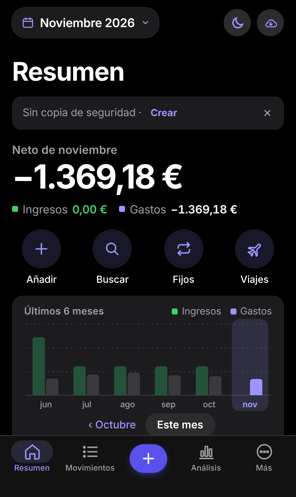

# Mis Gastos

A personal expense and income tracker in **a single HTML file**: no server, no dependencies, no account. It runs in the browser on mobile and desktop, has light and dark themes, and besides recording transactions it tells you how you are doing: end-of-month forecast, fixed payments, habit changes, trips and alerts.

It also includes a **weekly email summary** (headline, three sentences and one chart) generated with Python from the same data.

The app's interface, category names and emails are in **Spanish (Spain)**; the code and documentation are in English.

> All data in this repository is **invented** (`datos-ejemplo/`). There are no real transactions from anyone.

| Summary (mobile) | Analysis | Dark mode |
|---|---|---|
|  |  |  |


## Try it

- **Demo:** open [`docs/index.html`](docs/index.html) in your browser, or the GitHub Pages version if enabled (*Settings → Pages → Deploy from a branch → `main` / `docs`*). The first time it loads 897 invented transactions, shifted in time so the last month is the current one. Anything you add is stored only in your browser.
- **Start with your own data:** open [`app/gastos-amigo.html`](app/gastos-amigo.html). It starts empty with 16 basic categories and keeps everything in the browser. You can import a CSV from your bank or another app (it detects date, amount, type, category and note columns, in English or Spanish) and export backups as CSV or JSON.

## Features

- **Resumen (summary):** month net, income and expenses, last 6 months, forecast of how the month will end (with a range and how much you will save) and alerts.
- **Movimientos (transactions):** list by day with search, filters, editing, multi-select and labels. It suggests a category as you type the note.
- **Análisis (analysis):** overview, habits (pace by category and habit changes), compare periods, **fixed payments** (detects subscriptions and bills, warns when one goes up, goes down, is missing or a new one appears) and **trips**.
- **Evolución** (month by month) and **Categorías y presupuestos** (categories and budgets), with colours, icons and a monthly budget.
- **Extraordinary** expenses (a one-off big purchase) that do not distort the "normal month".

## Structure

Folder names are in Spanish, like the app.

```
app/
  gastos.html          The app (main version). Built to be published as a claude.ai artifact, where it stores
                       data in a cloud database; anywhere else it uses localStorage.
  gastos-amigo.html    Standalone variant: localStorage only, starts empty with basic categories.
datos-ejemplo/         Sample data
  generar.py           Generates the invented data (fixed seed: always the same output).
  months/YYYY-MM.json  Transactions per month.
  meta/config.json     Categories.
correo-semanal/        Weekly email summary (see below).
docs/
  index.html           Demo with the sample data (built by herramientas/construir-demo.py).
  capturas/            Screenshots of the demo.
  MAINTENANCE.md       How the app is built inside and how to change it without breaking it.
herramientas/          Tools
  construir-demo.py    Rebuilds docs/index.html from app/gastos.html and datos-ejemplo/.
tests/
  calc.test.js         14 checks of the calculations (forecast, savings, fixed payments, alerts...).
  snap.js, snapdiff.js Visual regression: computed style of every screen and a diff between versions.
  tools/cssmerge.py    Safely merges repeated CSS rules.
```

## Data model

Transactions are stored per month (`months/YYYY-MM`) and settings in `meta/config`:

```jsonc
// months/2026-10.json
{ "txs": [
  { "id": "s1a2b3c4d5", "d": "2026-10-03T08:15", "k": "e", "c": "e-transporte", "a": 20, "n": "Abono transporte" },
  { "id": "s6e7f8a9b0", "d": "2026-10-28T09:05", "k": "i", "c": "i-salario", "a": 2450, "n": "Nómina" }
]}
```

| Field | Meaning |
|---|---|
| `d` | Local date and time, `YYYY-MM-DDTHH:MM` |
| `k` | `e` expense, `i` income |
| `c` | Category id (from `meta/config.json`) |
| `a` | Amount, always positive |
| `n` | Free-text note. For trips, the destination goes in the note ("Vuelos Roma") |
| `l` | Comma-separated labels (optional) |
| `x` | `true` if extraordinary (optional) |

```jsonc
// meta/config.json
{ "cats": [ { "id": "e-supermercado", "name": "Supermercado", "kind": "e", "icon": "🛒", "color": "#F2A541", "budget": 260 } ],
  "currency": "EUR", "v": 1 }
```

In local mode everything lives in a single `localStorage` key, `gastos.local.v1`, shaped as `{ "txs": [...], "cats": [...] }`.

### How the figures are computed

- **Normal month:** average of the last 6 complete months, excluding extraordinary items.
- **End-of-month forecast:** spent so far + pending fixed payments + expected day-to-day spending + unexpected items. On the sample data, the mean error in the historical back-test (cut-offs on days 5, 10, 15, 20 and 25 of each month) is 16 %.
- **One-off expense:** extraordinary, 150 € or more, or a trip. Kept out of the daily pace.
- **Fixed payments:** same note or amount in at least 3 months, roughly once a month, with amounts within ±35 %.
- **Habit change:** a category or a word in the notes whose median over the last 3 months is at least twice the average of the previous 6 (and at least 25 €/month more).

More detail in [`docs/MAINTENANCE.md`](docs/MAINTENANCE.md).

## Weekly email summary

`correo-semanal/correo.py` reads the data, works out the week and the month, and builds an email ready to send:


**Requirements:** Python 3.10 or later (standard library only), Node.js and Playwright with Chromium (to render the chart as a PNG):

```bash
npm install playwright && npx playwright install chromium
```

**Usage:**

```bash
export MISGASTOS_URL="https://link-to-your-copy-of-the-app"   # "Abrir Mis Gastos" button (optional)
python3 correo-semanal/correo.py --db datos-ejemplo --hoy 2026-11-22 --outdir out
```

`--db` is a folder with the same layout as `datos-ejemplo/` (`months/*.json` and `meta/config.json`); `--hoy` is today's date. If your data lives in the app, export it or dump it into that layout. The script writes to `--outdir`:

- `correo.html`: HTML body for the email (the chart is an embedded image, `src="cid:att0"`).
- `correo.txt`: the same information as plain text.
- `grafico.png`: chart of the month and the categories.
- `datos.json`: every computed figure.

It also prints a JSON with the subject, headline, sentences and file paths. The script **does not send anything**: the caller does. In my setup it is a scheduled Claude task that runs on Sunday afternoons, reads the app's data and creates a Gmail draft with `correo.html`, `correo.txt` and `grafico.png` as an inline attachment (see [`correo-semanal/example-task.md`](correo-semanal/example-task.md)). Any other scheduler (cron, GitHub Actions...) with an SMTP client works just as well.

If the week has no transactions, no image is generated and the email is a single line. The design stays readable when the mail client strips backgrounds, and it has a dark mode for Apple Mail.

## Development

Requirements: Node.js with Playwright (`npm install playwright && npx playwright install chromium`) and Python 3.

```bash
node tests/calc.test.js                          # calculations: all 14 checks must pass
node tests/snap.js app/gastos.html /tmp/before   # style of every screen (before the change)
# ... make the change ...
node tests/snap.js app/gastos.html /tmp/after
node tests/snapdiff.js /tmp/before /tmp/after    # which elements change and in which property
python3 herramientas/construir-demo.py           # update the demo
```

The tests use `datos-ejemplo/` and a fixed date (30 October 2026), so their figures do not depend on the day you run them. If you regenerate the sample data with different rules, the figures change and must be pinned again.

## How it was made

The app was built iteratively with Claude (Anthropic), from v1 to the current v19, with technical review rounds, accuracy back-tests of the forecast on historical data, and a redesign that looks like a native iPhone app.

## License

[MIT](LICENSE)
